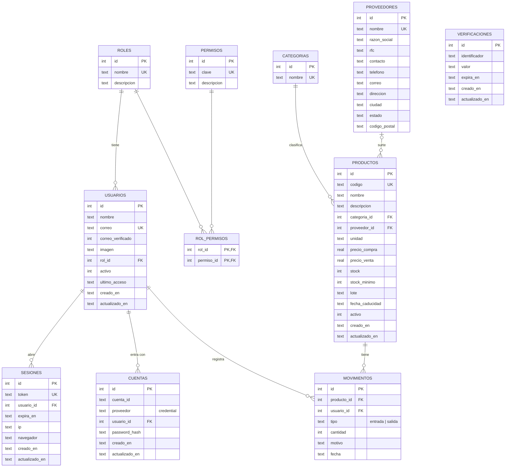

# Diseño de la base de datos — Sistema Puppy and Kitty

Sistema interno con login para el personal de la clínica. El primer módulo es el **inventario**
(medicamentos, vacunas, alimento, material de curación…) y el acceso se controla con **roles**.

- **Motor:** Cloudflare D1 (SQLite)
- **Scripts SQL:** [`migrations/0001_esquema_inicial.sql`](../migrations/0001_esquema_inicial.sql) (tablas)
  y [`migrations/0002_datos_proveedor.sql`](../migrations/0002_datos_proveedor.sql) (datos completos del proveedor)
- **Login:** [Better Auth](https://www.better-auth.com) con correo y contraseña. Usa las tablas `usuarios`,
  `cuentas`, `sesiones` y `verificaciones` ([`migrations/0003_better_auth.sql`](../migrations/0003_better_auth.sql));
  sus columnas en español se mapean en [`src/lib/auth.ts`](../src/lib/auth.ts)

## Diagrama entidad-relación

## Diccionario de datos

### Seguridad y acceso

**`roles`**: tipos de usuario.

| Campo | Tipo | Reglas | Descripción |
|---|---|---|---|
| id | INTEGER | PK | Identificador |
| nombre | TEXT | obligatorio, único | Administrador, Veterinario, Recepción |
| descripcion | TEXT | | Qué hace el rol |

**`permisos`**: acciones que el sistema puede permitir o negar.

| Campo | Tipo | Reglas | Descripción |
|---|---|---|---|
| id | INTEGER | PK | Identificador |
| clave | TEXT | obligatorio, único | Nombre que revisa el código (`inventario.editar`) |
| descripcion | TEXT | obligatorio | Texto para mostrar al usuario |

**`rol_permisos`**: une roles y permisos (relación muchos a muchos). La llave primaria es `(rol_id, permiso_id)`.

**`usuarios`**: personal con acceso al sistema.

| Campo | Tipo | Reglas | Descripción |
|---|---|---|---|
| id | INTEGER | PK | Identificador |
| nombre | TEXT | obligatorio | Nombre completo |
| correo | TEXT | obligatorio, único (sin importar mayúsculas) | Se usa para iniciar sesión |
| correo_verificado | INTEGER | 0 o 1, por defecto 0 | Lo pide Better Auth; por ahora no se verifica el correo |
| imagen | TEXT | | Foto de perfil (lo pide Better Auth; sin uso) |
| rol_id | INTEGER | FK → roles | Rol del usuario |
| activo | INTEGER | 0 o 1, por defecto 1 | Un usuario desactivado no puede entrar |
| ultimo_acceso | TEXT | | Fecha y hora del último login |
| creado_en | TEXT | por defecto ahora | Fecha de alta |
| actualizado_en | TEXT | | Último cambio |

**`cuentas`**: formas de iniciar sesión de cada usuario (tabla de Better Auth). Solo se usa correo y
contraseña, así que hay una por usuario. La llave única `(usuario_id, proveedor)` evita duplicados.

| Campo | Tipo | Reglas | Descripción |
|---|---|---|---|
| id | INTEGER | PK | Identificador |
| cuenta_id | TEXT | obligatorio | Con correo y contraseña es el id del usuario |
| proveedor | TEXT | obligatorio | `credential` = correo y contraseña |
| usuario_id | INTEGER | FK → usuarios, se borra en cascada | Dueño de la cuenta |
| password_hash | TEXT | | Contraseña cifrada con PBKDF2-SHA256 y sal; **nunca** en texto plano |
| token_*, alcance | TEXT | | Solo los usaría un login con Google u otro proveedor (sin uso) |
| creado_en, actualizado_en | TEXT | | |

**`sesiones`**: sesiones abiertas (tabla de Better Auth).

| Campo | Tipo | Reglas | Descripción |
|---|---|---|---|
| id | INTEGER | PK | Identificador |
| token | TEXT | obligatorio, único | Lo lleva la cookie, firmado con `BETTER_AUTH_SECRET` |
| usuario_id | INTEGER | FK → usuarios, se borra en cascada | Dueño de la sesión |
| expira_en | TEXT | obligatorio | La sesión dura 8 horas (un turno) y no se alarga |
| ip, navegador | TEXT | | Desde dónde se inició la sesión |
| creado_en, actualizado_en | TEXT | | |

**`verificaciones`**: códigos temporales de Better Auth (p. ej. recuperar la contraseña por correo).
Por ahora no se usa, pero Better Auth la requiere.

### Inventario

**`categorias`**: Medicamentos, Vacunas, Alimento, Material de curación, Higiene y estética, Accesorios.

**`proveedores`**: empresas que surten productos a la clínica. Tiene 10 campos de datos y en el
inventario cada producto enlaza a la ficha de su proveedor.

| Campo | Tipo | Reglas | Descripción |
|---|---|---|---|
| id | INTEGER | PK | Identificador |
| nombre | TEXT | obligatorio, único | Nombre comercial |
| razon_social | TEXT | | Nombre legal (para facturas) |
| rfc | TEXT | 12 o 13 caracteres | Registro Federal de Contribuyentes |
| contacto | TEXT | | Persona con quien se hacen los pedidos |
| telefono | TEXT | | |
| correo | TEXT | | |
| direccion | TEXT | | Calle, número y colonia |
| ciudad | TEXT | | |
| estado | TEXT | | |
| codigo_postal | TEXT | 5 dígitos | Se guarda como texto para no perder ceros (`03230`) |

**`productos`**

| Campo | Tipo | Reglas | Descripción |
|---|---|---|---|
| id | INTEGER | PK | Identificador |
| codigo | TEXT | obligatorio, único | SKU o código de barras (ej. `MED-001`) |
| nombre | TEXT | obligatorio | Nombre comercial |
| descripcion | TEXT | | Notas |
| categoria_id | INTEGER | FK → categorias | |
| proveedor_id | INTEGER | FK → proveedores, opcional | Si se borra el proveedor queda en NULL |
| unidad | TEXT | por defecto `pieza` | pieza, caja, frasco, dosis, bolsa… |
| precio_compra | REAL | ≥ 0 | Lo que le cuesta a la clínica |
| precio_venta | REAL | ≥ 0 | Precio al cliente |
| stock | INTEGER | ≥ 0 | Existencias actuales |
| stock_minimo | INTEGER | ≥ 0 | Si `stock ≤ stock_minimo` el sistema avisa |
| lote | TEXT | | Lote del fabricante |
| fecha_caducidad | TEXT | AAAA-MM-DD | El sistema avisa 60 días antes |
| activo | INTEGER | 0 o 1 | "Dar de baja" en vez de borrar, para conservar el historial |
| creado_en / actualizado_en | TEXT | | Fechas de control |

**`movimientos`**: historial de entradas y salidas.

| Campo | Tipo | Reglas | Descripción |
|---|---|---|---|
| id | INTEGER | PK | Identificador |
| producto_id | INTEGER | FK → productos | Producto afectado |
| usuario_id | INTEGER | FK → usuarios | Quién lo registró |
| tipo | TEXT | `entrada` o `salida` | |
| cantidad | INTEGER | > 0 | |
| motivo | TEXT | | Compra, consulta, venta, caducado… |
| fecha | TEXT | por defecto ahora | |

### Reglas de negocio

1. **El stock solo cambia con movimientos.** Al registrar una entrada o salida, en una sola transacción
   se actualiza `productos.stock` y se inserta la fila en `movimientos`. Si una salida dejaría el stock
   en negativo, la restricción `CHECK (stock >= 0)` la rechaza y no se guarda nada.
2. Al crear un producto con stock inicial se registra una entrada con motivo "Inventario inicial".
3. Los productos y los usuarios no se borran, se **desactivan**.
4. Un administrador no puede quitarse su propio rol ni desactivarse (para no quedarse sin acceso).

## Roles y permisos

| Permiso | Administrador | Veterinario | Recepción |
|---|:-:|:-:|:-:|
| Ver productos y existencias (`inventario.ver`) | ✅ | ✅ | ✅ |
| Registrar entradas y salidas (`inventario.movimiento`) | ✅ | ✅ | ❌ |
| Crear, editar y dar de baja productos (`inventario.editar`) | ✅ | ❌ | ❌ |
| Crear usuarios y asignar roles (`usuarios.administrar`) | ✅ | ❌ | ❌ |

Para agregar un rol o un permiso nuevo basta con insertar filas en `roles`, `permisos` y `rol_permisos`.
El código revisa los permisos, no los nombres de los roles.
